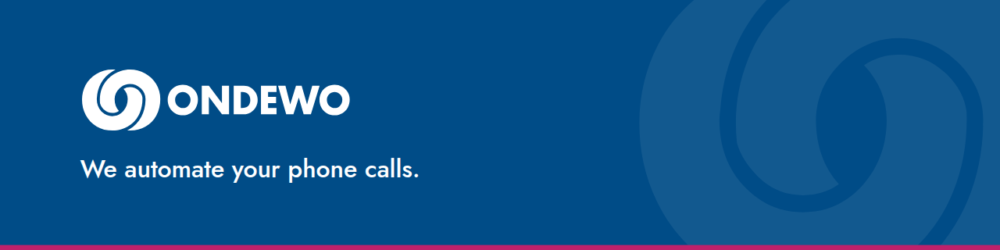

# ONDEWO on Bitbucket

> Source hosting (developer) · Public/partner repositories and internal code: consistent workspace identity and READMEs.
>
> Handle / URL: bitbucket.org/ondewo ‹confirm›

Everything here follows the [brand kit](../../README.md): blue `#004C87` base, magenta `#BE216B`
accent only (≤ 10%), Jost/Futura type, the official swirl logo (never redrawn). Copy follows
[voice-and-tone](../../voice-and-tone.md): sentence-case headlines, `ONDEWO` always all-caps.

> Platform specs change often. Treat the sizes below as recommendations and verify them in the
> platform before uploading. Items marked ‹confirm› are not yet confirmed by ONDEWO marketing.

## Specs

| Item | Recommendation |
|---|---|
| Avatar | Square PNG, ≥ 128 × 128 (we supply 256 × 256); shown in small circles/squares, so the mark must stay centred |
| README header | 1280 × 320 px (4:1), referenced from the README as a relative image |
| Badges | Use brand blue `004C87` for the badge colour (see snippets in the README) |

## Assets

| File | Size (px) | Use |
|---|---|---|
| `avatar.png` | 256 × 256 | Workspace / project / repository avatar |
| `avatar-blue.png` | 256 × 256 | Alternative avatar for dark themes |
| `readme-header.png` | 1280 × 320 | Header image at the top of a repository README |

Files live in [`images/`](images/) as editable SVG (open it, replace the placeholder text) and
exported PNG. Regenerate everything with `make social` from the repository root.

**Workspace / project / repository avatar** — `256×256`


**Alternative avatar for dark themes** — `256×256`


**Header image at the top of a repository README** — `1280×320`



## Alt text

Always add alt text when uploading:

- `avatar`: “ONDEWO swirl logomark on white”
- `avatar-blue`: “ONDEWO swirl logomark in white on blue”
- `readme-header`: “ONDEWO logo and tagline on blue”

For post templates, extend it with the real headline, e.g. “ONDEWO: Answer every call, around the clock.”

## README snippet

```markdown


# ONDEWO <Product>

> We automate your phone calls.


```

## More

- [Profile copy](profile-copy.md) — names, bios and descriptions to paste, with character limits
- [Content guidelines](content-guidelines.md) — tone, hooks, do and don't
- [Social kit index](../README.md)
