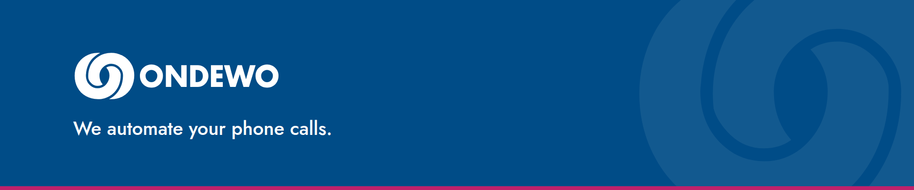

# ONDEWO on Confluence

> Documentation (internal / partner) · Spaces, runbooks and how-to guides in the ONDEWO voice.
>
> Handle / URL: <site>.atlassian.net/wiki ‹confirm›

Everything here follows the [brand kit](../../README.md): blue `#004C87` base, magenta `#BE216B`
accent only (≤ 10%), Jost/Futura type, the official swirl logo (never redrawn). Copy follows
[voice-and-tone](../../voice-and-tone.md): sentence-case headlines, `ONDEWO` always all-caps.

> Platform specs change often. Treat the sizes below as recommendations and verify them in the
> platform before uploading. Items marked ‹confirm› are not yet confirmed by ONDEWO marketing.

## Specs

| Item | Recommendation |
|---|---|
| Space icon | Square PNG, supply 256 × 256 |
| Page header image | 1920 × 400 px (wide banner, keep content in the left 60%) |
| Panels | Info = blue-50 `#EBF1F5` with `#004C87`; note/important = magenta accent sparingly; success `#1E7A4B`, warning `#B5710A`, error `#C02626` |
| Page title | Sentence case, ≤ 60 characters |

## Assets

| File | Size (px) | Use |
|---|---|---|
| `avatar.png` | 256 × 256 | Space icon / site logo |
| `avatar-blue.png` | 256 × 256 | Space icon variant |
| `page-banner.png` | 1920 × 400 | Page header / cover image |

Files live in [`images/`](images/) as editable SVG (open it, replace the placeholder text) and
exported PNG. Regenerate everything with `make social` from the repository root.

**Space icon / site logo** — `256×256`

**Space icon variant** — `256×256`

**Page header / cover image** — `1920×400`

## Alt text

Always add alt text when uploading:

- `avatar`: “ONDEWO swirl logomark on white”
- `avatar-blue`: “ONDEWO swirl logomark in white on blue”
- `page-banner`: “ONDEWO logo and tagline on blue”

For post templates, extend it with the real headline, e.g. “ONDEWO: Answer every call, around the clock.”

## More

- [Profile copy](profile-copy.md) — names, bios and descriptions to paste, with character limits
- [Content guidelines](content-guidelines.md) — tone, hooks, do and don't
- [Social kit index](../README.md)
