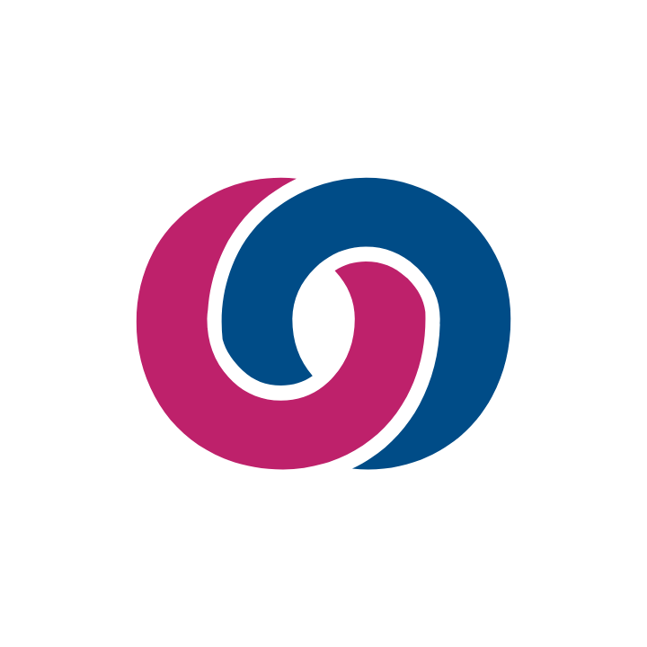
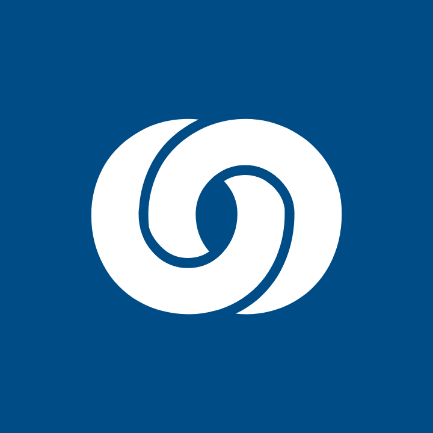
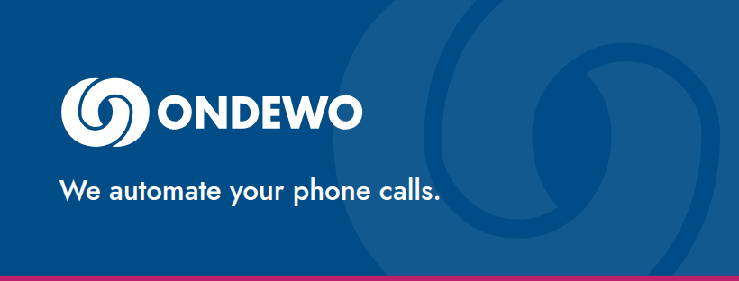
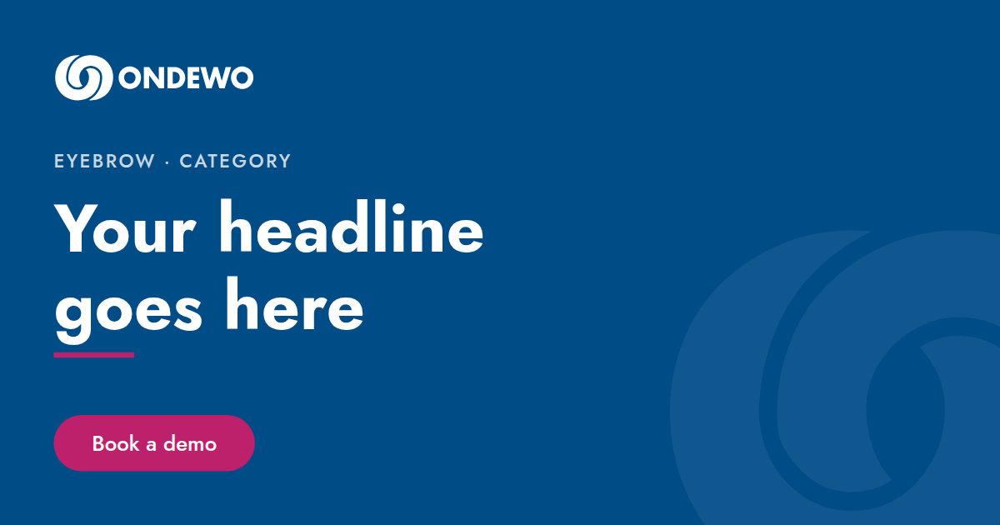
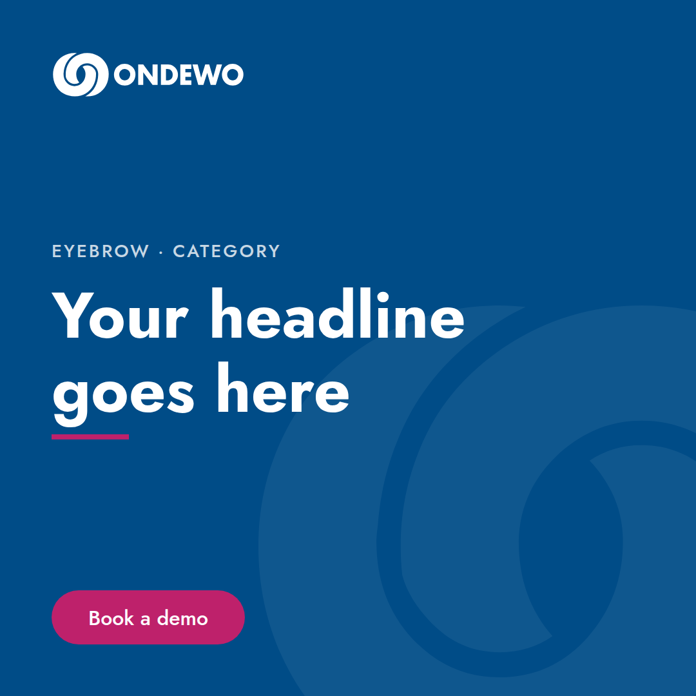
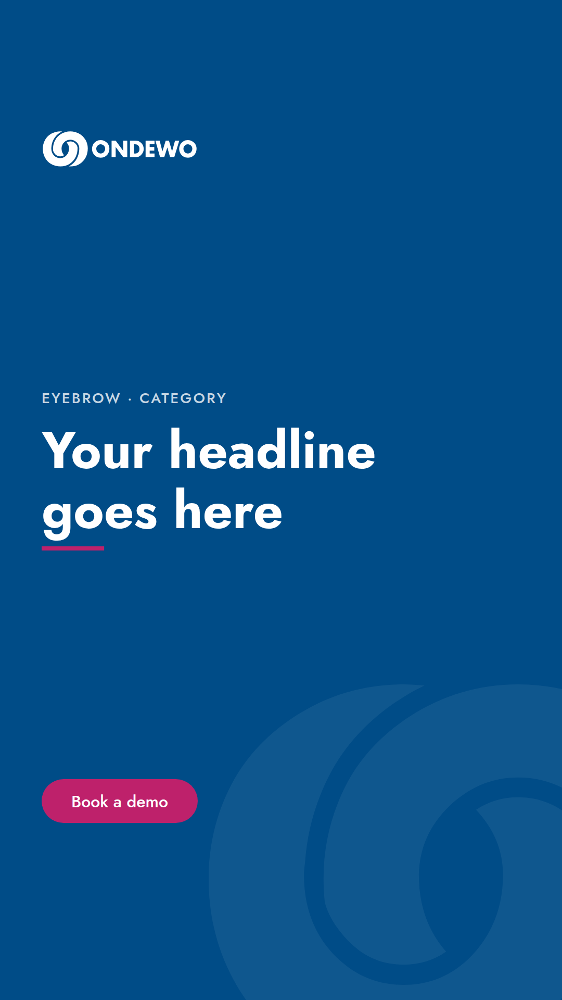
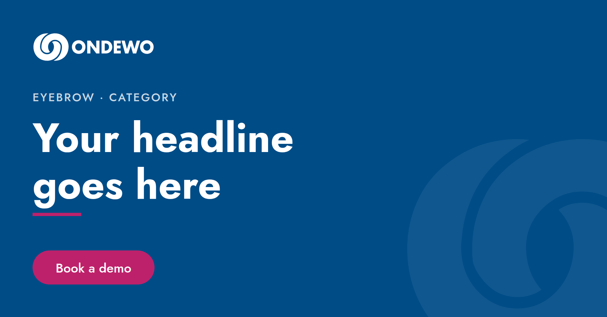

# ONDEWO on Facebook

> Social network · Reach for events, webinars, employer brand and community updates.
>
> Handle / URL: facebook.com/ondewo ‹confirm›

Everything here follows the [brand kit](../../README.md): blue `#004C87` base, magenta `#BE216B`
accent only (≤ 10%), Jost/Futura type, the official swirl logo (never redrawn). Copy follows
[voice-and-tone](../../voice-and-tone.md): sentence-case headlines, `ONDEWO` always all-caps.

> Platform specs change often. Treat the sizes below as recommendations and verify them in the
> platform before uploading. Items marked ‹confirm› are not yet confirmed by ONDEWO marketing.

> The repository root already contains the legacy `ondewo_facebook_profile.png`; the generated avatar replaces it.

## Specs

| Item | Recommendation |
|---|---|
| Profile picture | Upload ≥ 320 × 320 px (shown at 170 px on desktop, circular crop) |
| Cover photo | 820 × 312 px; keep logo and text in the centre 640 px for mobile |
| Feed image | 1200 × 630 (link share) or 1080 × 1080 / 1080 × 1350 |
| Story / Reel | 1080 × 1920 (9:16); keep text ≥ 250 px from the top and ≥ 340 px from the bottom |
| Event cover | 1920 × 1005 px |
| Post length | Short: 40–80 characters perform best; hard limit is far higher |

## Assets

| File | Size (px) | Use |
|---|---|---|
| `avatar.png` | 720 × 720 | Page profile picture (shown as a circle) |
| `avatar-blue.png` | 720 × 720 | Alternative profile picture |
| `cover.png` | 820 × 312 | Page cover (mobile crops to the centre ≈ 640 × 360) |
| `post-landscape.png` | 1200 × 630 | Link / image post (1.91:1) |
| `post-square.png` | 1080 × 1080 | Feed image (1:1) |
| `story.png` | 1080 × 1920 | Story / Reel (9:16) |
| `event-cover.png` | 1920 × 1005 | Event cover (webinars) |

Files live in [`images/`](images/) as editable SVG (open it, replace the placeholder text) and
exported PNG. Regenerate everything with `make social` from the repository root.

**Page profile picture (shown as a circle)** — `720×720`

**Alternative profile picture** — `720×720`

**Page cover (mobile crops to the centre ≈ 640 × 360)** — `820×312`

**Link / image post (1.91:1)** — `1200×630`

**Feed image (1:1)** — `1080×1080`

**Story / Reel (9:16)** — `1080×1920`

**Event cover (webinars)** — `1920×1005`

## Alt text

Always add alt text when uploading:

- `avatar`: “ONDEWO swirl logomark on white”
- `avatar-blue`: “ONDEWO swirl logomark in white on blue”
- `cover`: “ONDEWO logo and tagline on blue”
- `post-landscape`: “ONDEWO post template with headline placeholder”
- `post-square`: “ONDEWO square post template”
- `story`: “ONDEWO story template with headline placeholder”
- `event-cover`: “ONDEWO event cover template”

For post templates, extend it with the real headline, e.g. “ONDEWO: Answer every call, around the clock.”

## Safe zone

Keep logo, headline and CTA at least **250 px from the top** and **340 px from the bottom** of 1080 × 1920 assets: the platform UI (name, caption, buttons) covers those areas. The story template already respects this.

## More

- [Profile copy](profile-copy.md) — names, bios and descriptions to paste, with character limits
- [Content guidelines](content-guidelines.md) — tone, hooks, do and don't
- [Social kit index](../README.md)
