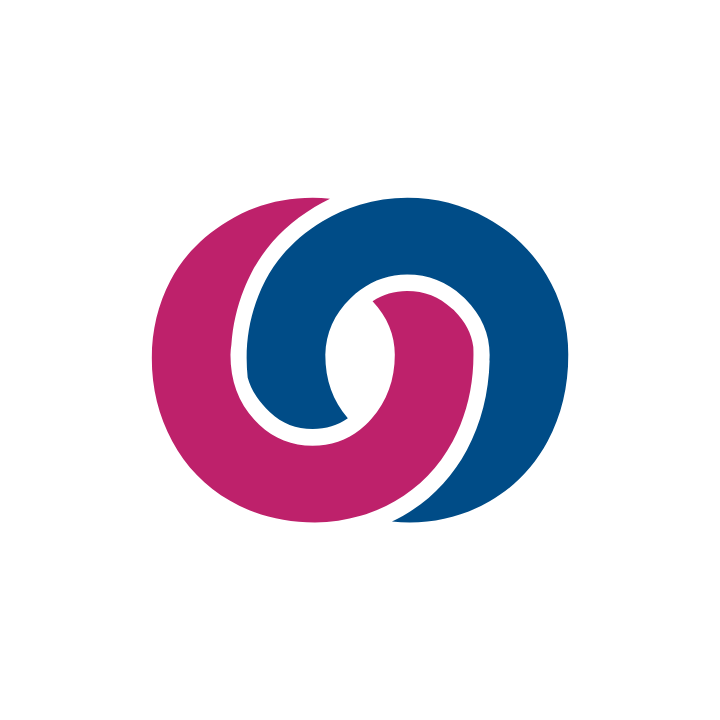
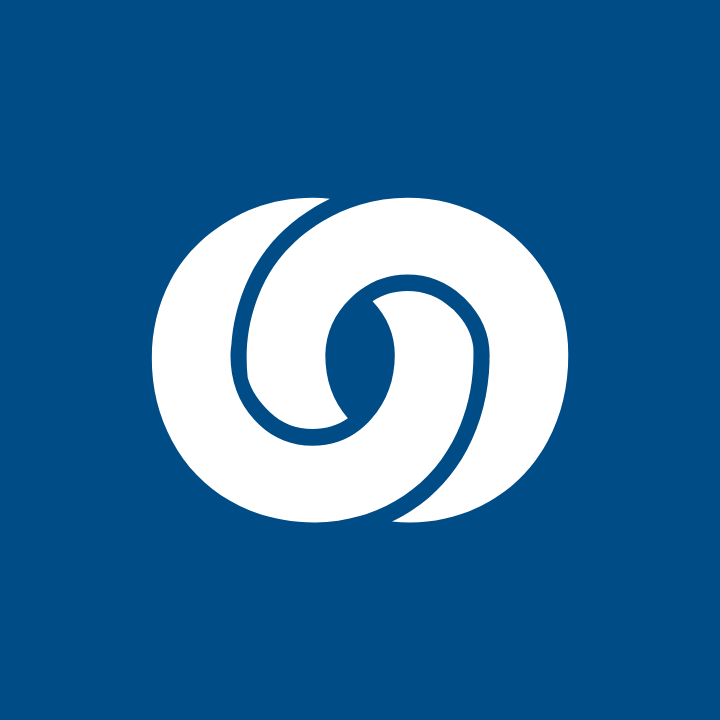
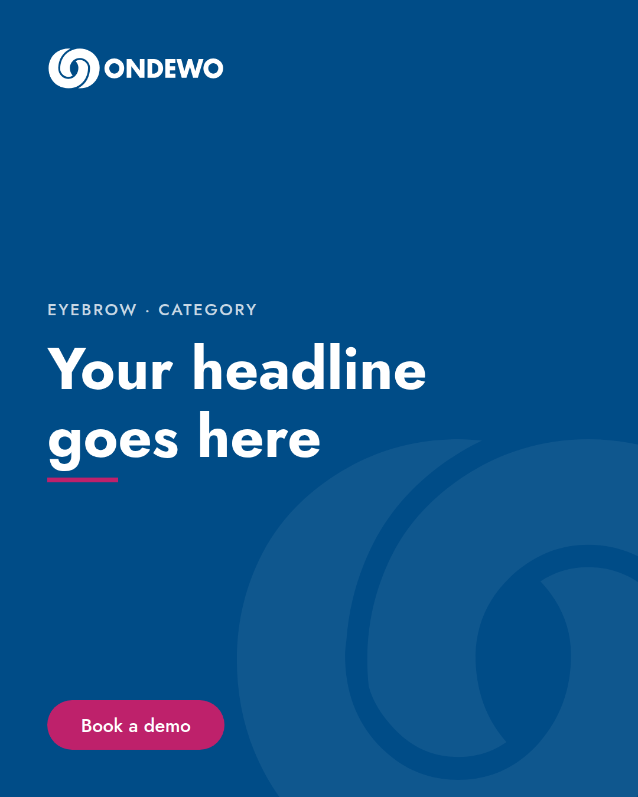
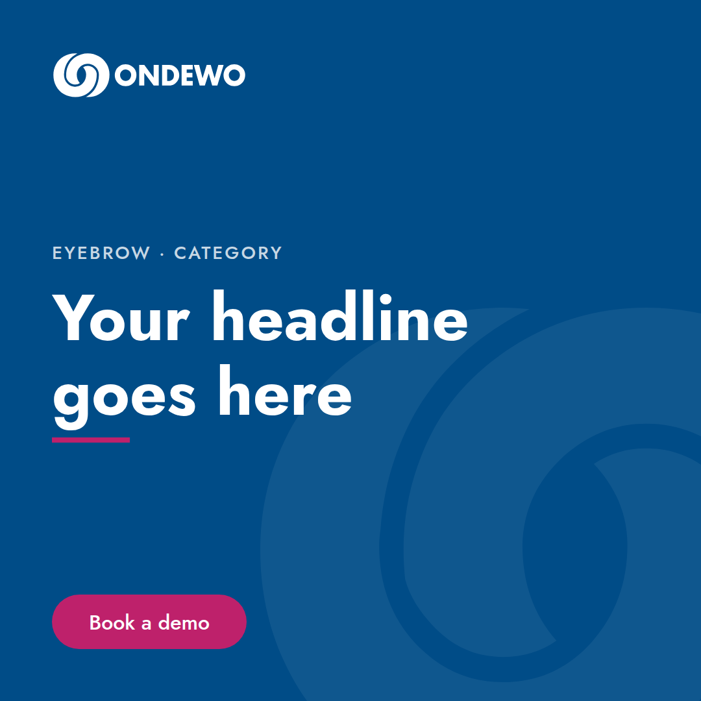
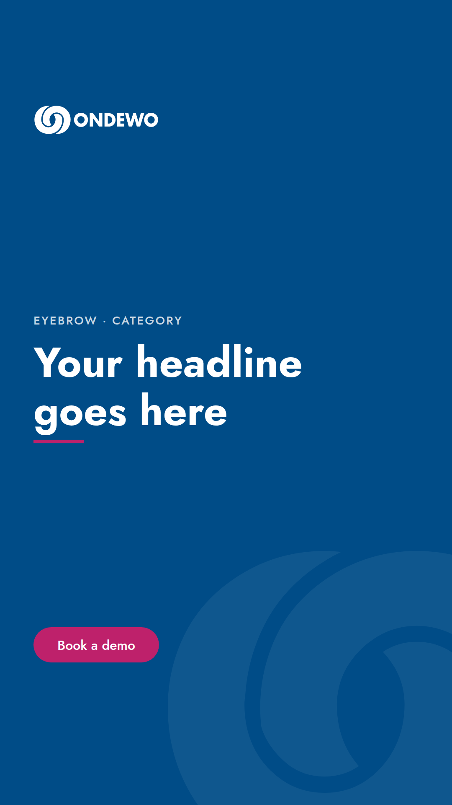
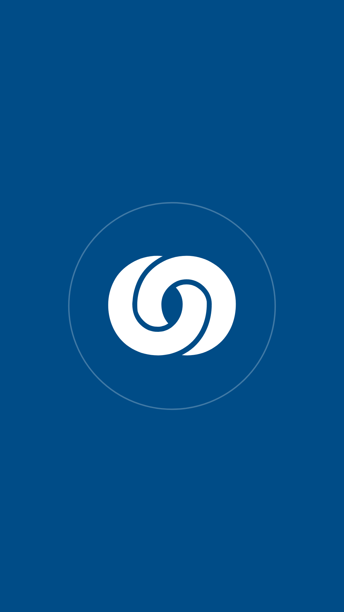

# ONDEWO on Instagram

> Social network (visual) · Employer brand, behind-the-scenes, short explainers and event highlights.
>
> Handle / URL: @ondewo ‹confirm›

Everything here follows the [brand kit](../../README.md): blue `#004C87` base, magenta `#BE216B`
accent only (≤ 10%), Jost/Futura type, the official swirl logo (never redrawn). Copy follows
[voice-and-tone](../../voice-and-tone.md): sentence-case headlines, `ONDEWO` always all-caps.

> Platform specs change often. Treat the sizes below as recommendations and verify them in the
> platform before uploading. Items marked ‹confirm› are not yet confirmed by ONDEWO marketing.

## Specs

| Item | Recommendation |
|---|---|
| Profile picture | Upload 720 × 720+ px square (displays at 110 px, circular) |
| Feed post / carousel | 1080 × 1350 (4:5, preferred), 1080 × 1080 (1:1) |
| Story / Reel | 1080 × 1920 (9:16); text ≥ 250 px from top and ≥ 340 px from bottom |
| Highlight cover | 1080 × 1920 with the icon in the centre circle |
| Bio | ≤ 150 characters, one link |
| Caption | ≈ 125 characters before ‘more’; ≤ 2,200 total; 5–10 hashtags (may sit in the first comment) |

## Assets

| File | Size (px) | Use |
|---|---|---|
| `avatar.png` | 720 × 720 | Profile picture (circular crop) |
| `avatar-blue.png` | 720 × 720 | Alternative profile picture |
| `post-portrait.png` | 1080 × 1350 | Feed post and carousel slide (4:5) |
| `post-square.png` | 1080 × 1080 | Feed post (1:1) |
| `story.png` | 1080 × 1920 | Story / Reel cover (9:16) |
| `highlight-cover.png` | 1080 × 1920 | Story highlight cover (swirl centred) |

Files live in [`images/`](images/) as editable SVG (open it, replace the placeholder text) and
exported PNG. Regenerate everything with `make social` from the repository root.

**Profile picture (circular crop)** — `720×720`

**Alternative profile picture** — `720×720`

**Feed post and carousel slide (4:5)** — `1080×1350`

**Feed post (1:1)** — `1080×1080`

**Story / Reel cover (9:16)** — `1080×1920`

**Story highlight cover (swirl centred)** — `1080×1920`

## Alt text

Always add alt text when uploading:

- `avatar`: “ONDEWO swirl logomark on white”
- `avatar-blue`: “ONDEWO swirl logomark in white on blue”
- `post-portrait`: “ONDEWO portrait post template”
- `post-square`: “ONDEWO square post template”
- `story`: “ONDEWO story template with headline placeholder”
- `highlight-cover`: “ONDEWO swirl logomark on blue”

For post templates, extend it with the real headline, e.g. “ONDEWO: Answer every call, around the clock.”

## Safe zone

Keep logo, headline and CTA at least **250 px from the top** and **340 px from the bottom** of 1080 × 1920 assets: the platform UI (name, caption, buttons) covers those areas. The story template already respects this.

## More

- [Profile copy](profile-copy.md) — names, bios and descriptions to paste, with character limits
- [Content guidelines](content-guidelines.md) — tone, hooks, do and don't
- [Social kit index](../README.md)
