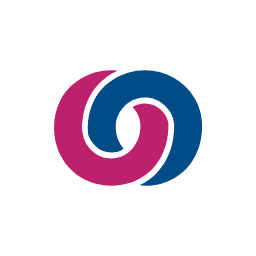
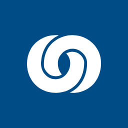
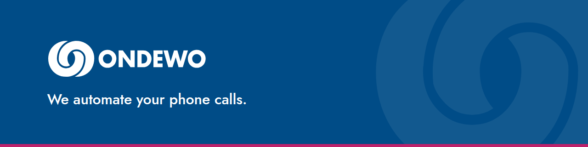

# ONDEWO on Jira

> Work management (internal / partner) · Consistent project identity and clear, calm ticket writing.
>
> Handle / URL: <site>.atlassian.net ‹confirm›

Everything here follows the [brand kit](../../README.md): blue `#004C87` base, magenta `#BE216B`
accent only (≤ 10%), Jost/Futura type, the official swirl logo (never redrawn). Copy follows
[voice-and-tone](../../voice-and-tone.md): sentence-case headlines, `ONDEWO` always all-caps.

> Platform specs change often. Treat the sizes below as recommendations and verify them in the
> platform before uploading. Items marked ‹confirm› are not yet confirmed by ONDEWO marketing.

## Specs

| Item | Recommendation |
|---|---|
| Site / project avatar | Square PNG, supply 256 × 256 (displayed from 24 px up) |
| Dashboard banner | 1280 × 320 px, added via a text gadget with an image attachment |
| Status lozenges | Do not recolour: Jira fixes them. Use brand colours for labels, dashboards and attachments only |
| Ticket title | Verb-first, ≤ 80 characters, sentence case |

## Assets

| File | Size (px) | Use |
|---|---|---|
| `avatar.png` | 256 × 256 | Site logo and project avatar |
| `avatar-blue.png` | 256 × 256 | Project avatar variant (e.g. to tell products apart) |
| `dashboard-banner.png` | 1280 × 320 | Banner for dashboards and board descriptions |

Files live in [`images/`](images/) as editable SVG (open it, replace the placeholder text) and
exported PNG. Regenerate everything with `make social` from the repository root.

**Site logo and project avatar** — `256×256`

**Project avatar variant (e.g. to tell products apart)** — `256×256`

**Banner for dashboards and board descriptions** — `1280×320`

## Alt text

Always add alt text when uploading:

- `avatar`: “ONDEWO swirl logomark on white”
- `avatar-blue`: “ONDEWO swirl logomark in white on blue”
- `dashboard-banner`: “ONDEWO logo and tagline on blue”

For post templates, extend it with the real headline, e.g. “ONDEWO: Answer every call, around the clock.”

## More

- [Profile copy](profile-copy.md) — names, bios and descriptions to paste, with character limits
- [Content guidelines](content-guidelines.md) — tone, hooks, do and don't
- [Social kit index](../README.md)
