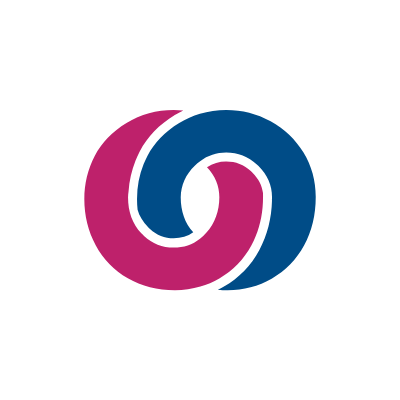
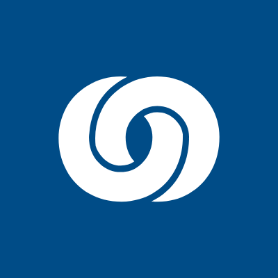
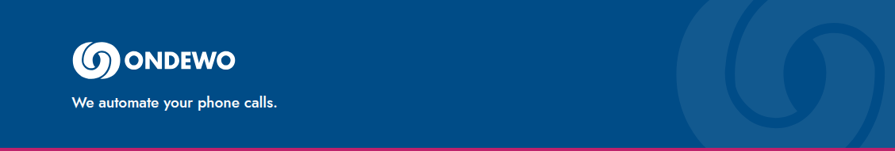
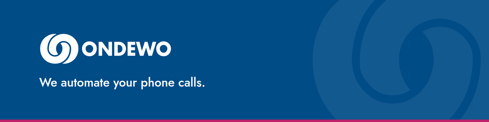
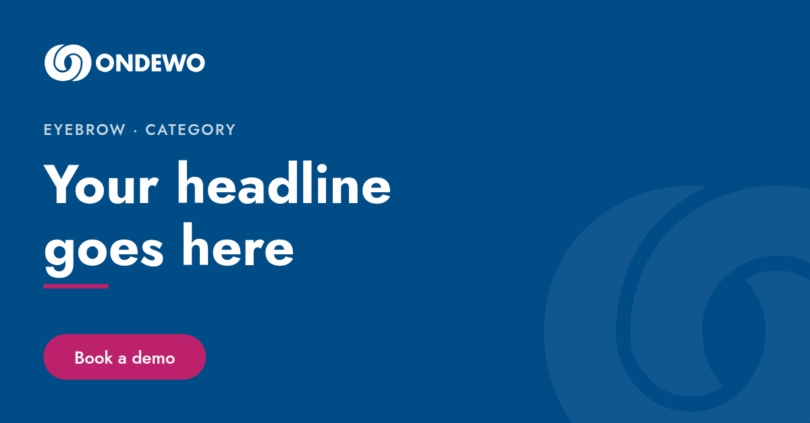
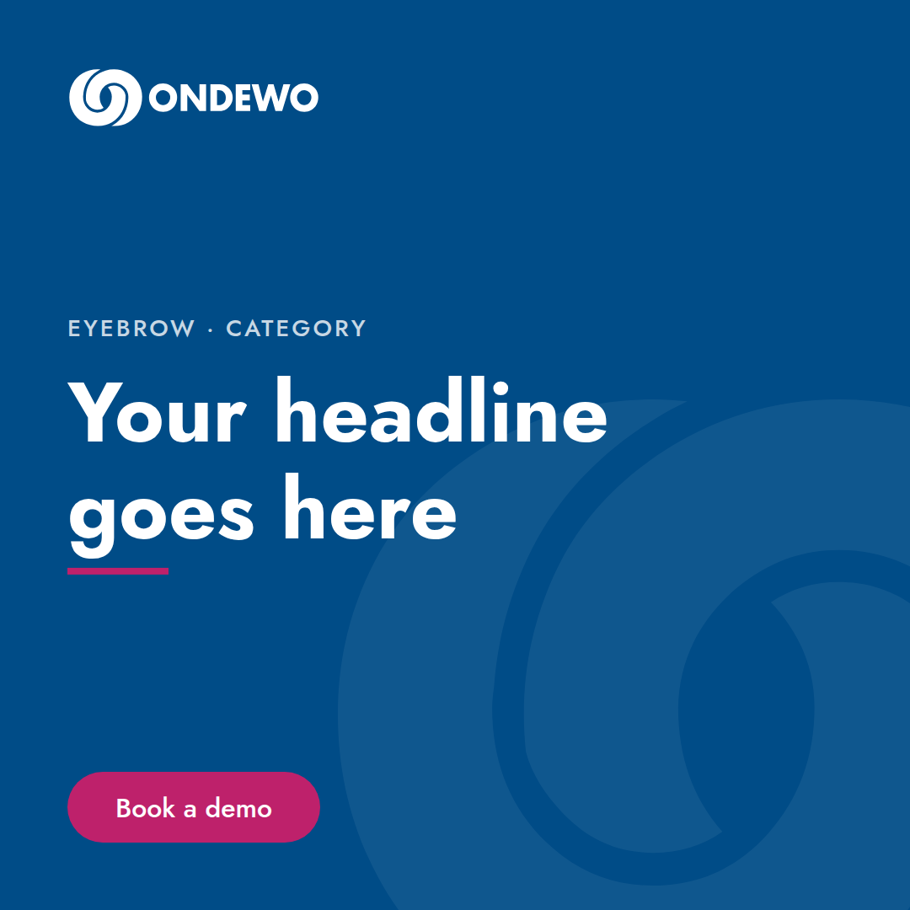
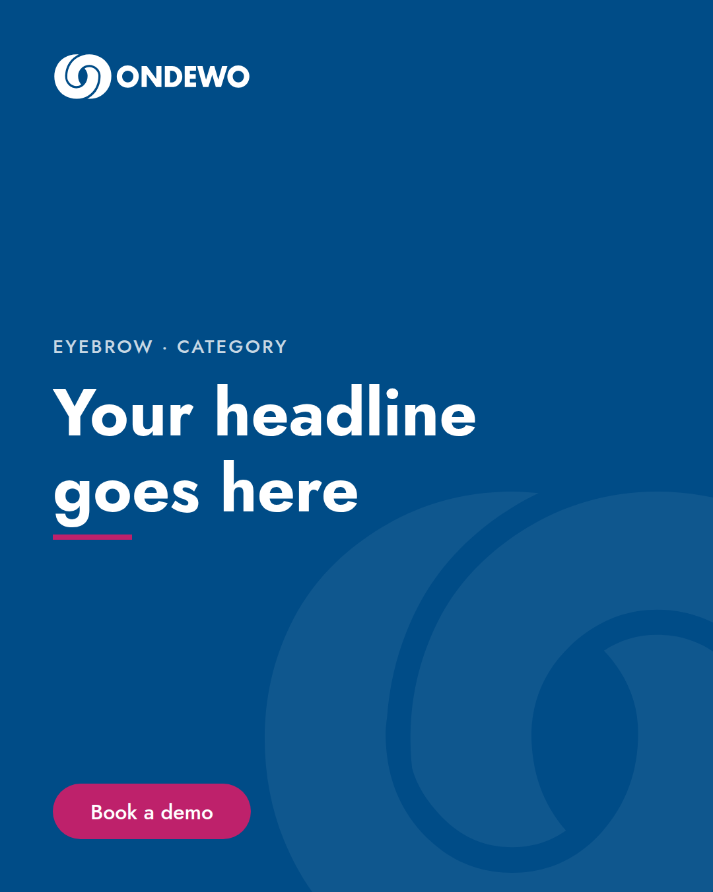

# ONDEWO on LinkedIn

> Social network (B2B) · Primary B2B channel: thought leadership, product news, hiring, events.
>
> Handle / URL: linkedin.com/company/ondewo ‹confirm›

Everything here follows the [brand kit](../../README.md): blue `#004C87` base, magenta `#BE216B`
accent only (≤ 10%), Jost/Futura type, the official swirl logo (never redrawn). Copy follows
[voice-and-tone](../../voice-and-tone.md): sentence-case headlines, `ONDEWO` always all-caps.

> Platform specs change often. Treat the sizes below as recommendations and verify them in the
> platform before uploading. Items marked ‹confirm› are not yet confirmed by ONDEWO marketing.

## Specs

| Item | Recommendation |
|---|---|
| Company logo | 400 × 400 px, square PNG; keep the mark inside the centre 70% |
| Company cover | 1128 × 191 px (personal profile cover: 1584 × 396 px) |
| Image post | 1200 × 627 (1.91:1), 1080 × 1080 (1:1) or 1080 × 1350 (4:5) |
| Carousel / document | PDF, 1080 × 1350 portrait slides, ≤ 10 slides recommended |
| Post length | ≈ 600–1,300 characters; the hook must fit in the first ≈ 140 before ‘see more’ |
| Hashtags | 3–5, at the end of the post |

## Assets

| File | Size (px) | Use |
|---|---|---|
| `avatar.png` | 400 × 400 | Company logo (cropped to a rounded square / circle) |
| `avatar-blue.png` | 400 × 400 | Alternative logo for dark-mode / event pages |
| `cover.png` | 1128 × 191 | Company page cover |
| `cover-personal.png` | 1584 × 396 | Employee / founder profile cover |
| `post-landscape.png` | 1200 × 627 | Link and single-image post (1.91:1) |
| `post-square.png` | 1080 × 1080 | Single-image post (1:1) |
| `carousel-slide.png` | 1080 × 1350 | Document / carousel slide (4:5) |

Files live in [`images/`](images/) as editable SVG (open it, replace the placeholder text) and
exported PNG. Regenerate everything with `make social` from the repository root.

**Company logo (cropped to a rounded square / circle)** — `400×400`

**Alternative logo for dark-mode / event pages** — `400×400`

**Company page cover** — `1128×191`

**Employee / founder profile cover** — `1584×396`

**Link and single-image post (1.91:1)** — `1200×627`

**Single-image post (1:1)** — `1080×1080`

**Document / carousel slide (4:5)** — `1080×1350`

## Alt text

Always add alt text when uploading:

- `avatar`: “ONDEWO swirl logomark on white”
- `avatar-blue`: “ONDEWO swirl logomark in white on blue”
- `cover`: “ONDEWO logo and tagline 'We automate your phone calls.' on blue”
- `cover-personal`: “ONDEWO logo and tagline on blue”
- `post-landscape`: “ONDEWO post template with headline placeholder”
- `post-square`: “ONDEWO square post template”
- `carousel-slide`: “ONDEWO carousel slide template”

For post templates, extend it with the real headline, e.g. “ONDEWO: Answer every call, around the clock.”

## More

- [Profile copy](profile-copy.md) — names, bios and descriptions to paste, with character limits
- [Content guidelines](content-guidelines.md) — tone, hooks, do and don't
- [Social kit index](../README.md)
