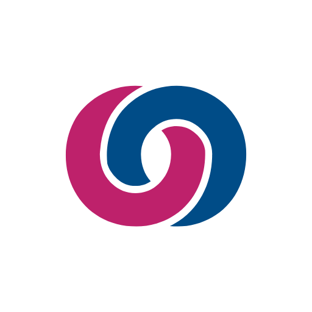
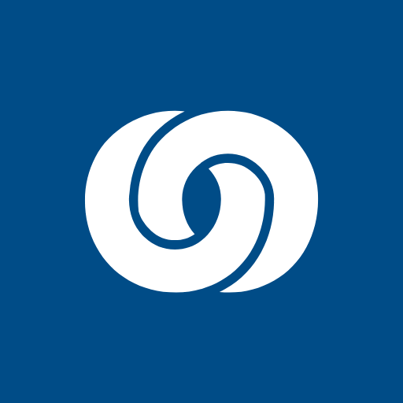
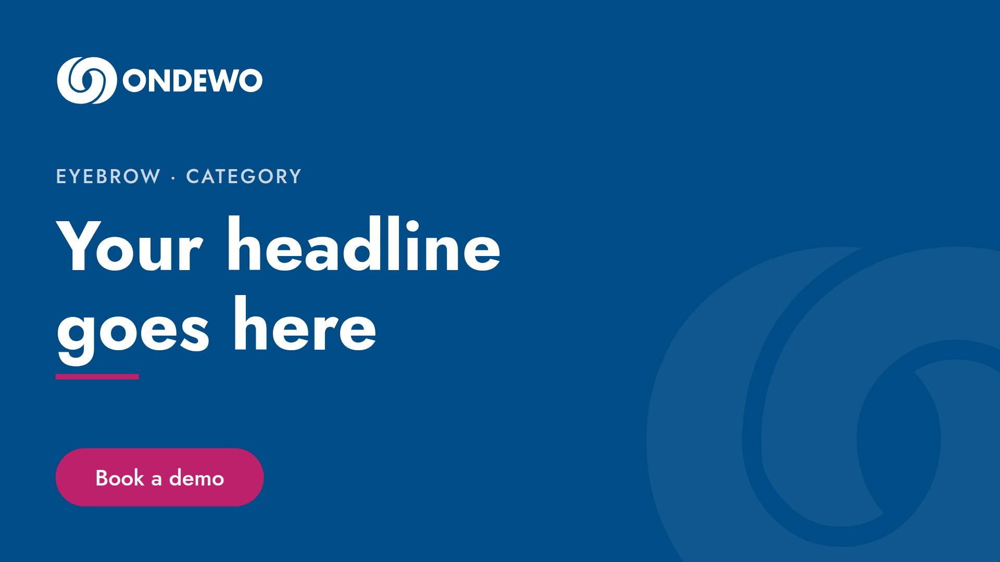

# ONDEWO on Roblox

> Gaming platform (experimental) · Optional, experimental channel for virtual events and recruiting. ONDEWO is a B2B voice-AI company, so presence is limited to a verified group and carefully scoped experiences. ‹confirm›
>
> Handle / URL: ONDEWO (group) ‹confirm›

Everything here follows the [brand kit](../../README.md): blue `#004C87` base, magenta `#BE216B`
accent only (≤ 10%), Jost/Futura type, the official swirl logo (never redrawn). Copy follows
[voice-and-tone](../../voice-and-tone.md): sentence-case headlines, `ONDEWO` always all-caps.

> Platform specs change often. Treat the sizes below as recommendations and verify them in the
> platform before uploading. Items marked ‹confirm› are not yet confirmed by ONDEWO marketing.

## Specs

| Item | Recommendation |
|---|---|
| Group / experience icon | 512 × 512 px square PNG (displayed small; keep the mark centred and large) |
| Experience thumbnail | 1920 × 1080 px (16:9), min 1280 × 720 |
| Audience | Includes minors: all content must be age-appropriate and follow Roblox Community Standards |

## Assets

| File | Size (px) | Use |
|---|---|---|
| `avatar.png` | 512 × 512 | Group icon / experience icon |
| `avatar-blue.png` | 512 × 512 | Alternative icon |
| `thumbnail.png` | 1920 × 1080 | Experience thumbnail (16:9) |

Files live in [`images/`](images/) as editable SVG (open it, replace the placeholder text) and
exported PNG. Regenerate everything with `make social` from the repository root.

**Group icon / experience icon** — `512×512`

**Alternative icon** — `512×512`

**Experience thumbnail (16:9)** — `1920×1080`

## Alt text

Always add alt text when uploading:

- `avatar`: “ONDEWO swirl logomark on white”
- `avatar-blue`: “ONDEWO swirl logomark in white on blue”
- `thumbnail`: “ONDEWO experience thumbnail template”

For post templates, extend it with the real headline, e.g. “ONDEWO: Answer every call, around the clock.”

## More

- [Profile copy](profile-copy.md) — names, bios and descriptions to paste, with character limits
- [Content guidelines](content-guidelines.md) — tone, hooks, do and don't
- [Social kit index](../README.md)
