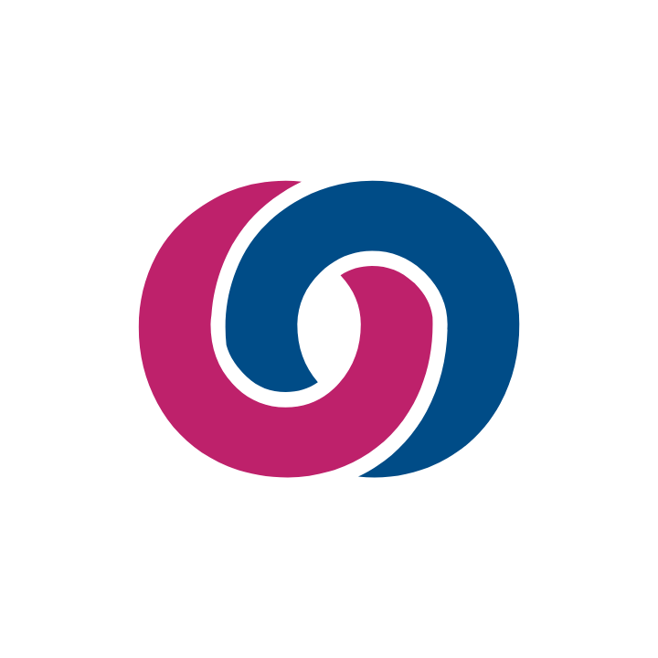
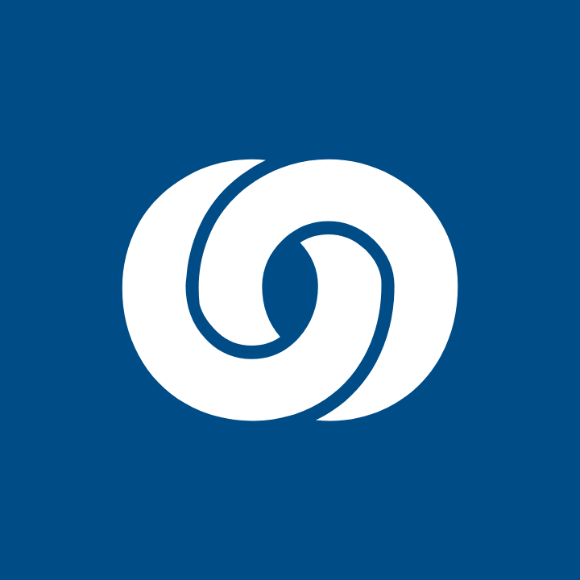
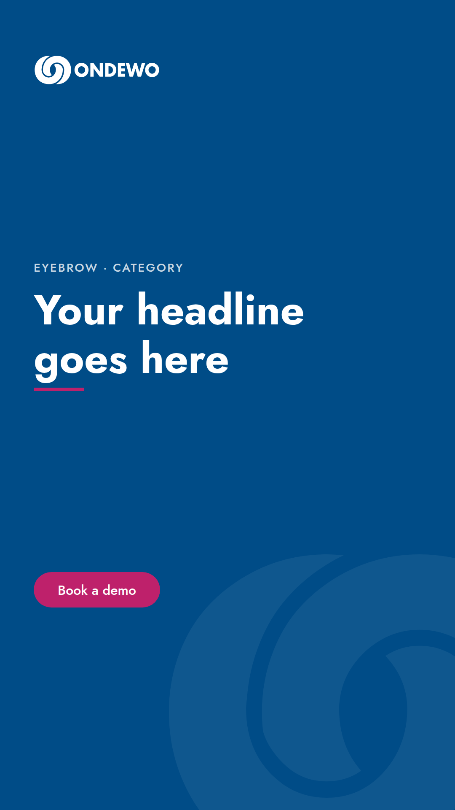
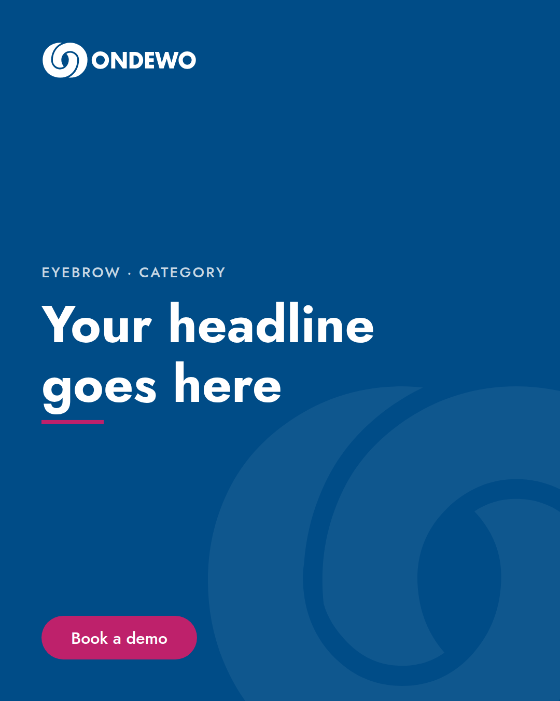

# ONDEWO on TikTok

> Short-form video · Employer brand and short, human explainers. Educational, never salesy. ‹confirm›
>
> Handle / URL: @ondewo ‹confirm›

Everything here follows the [brand kit](../../README.md): blue `#004C87` base, magenta `#BE216B`
accent only (≤ 10%), Jost/Futura type, the official swirl logo (never redrawn). Copy follows
[voice-and-tone](../../voice-and-tone.md): sentence-case headlines, `ONDEWO` always all-caps.

> Platform specs change often. Treat the sizes below as recommendations and verify them in the
> platform before uploading. Items marked ‹confirm› are not yet confirmed by ONDEWO marketing.

## Specs

| Item | Recommendation |
|---|---|
| Profile photo | Upload ≥ 200 × 200 px square (we supply 720 × 720); circular crop |
| Video | 1080 × 1920 (9:16), MP4/MOV; 15–60 s works best for B2B explainers |
| Safe zone | Keep text ≥ 130 px from the top and ≥ 480 px from the bottom (caption, buttons, sound label overlay) |
| Bio | ≤ 80 characters, one link |
| Caption | ≤ 4,000 characters; the first line is the hook; 3–5 hashtags |

## Assets

| File | Size (px) | Use |
|---|---|---|
| `avatar.png` | 720 × 720 | Profile photo (circular crop) |
| `avatar-blue.png` | 720 × 720 | Alternative profile photo |
| `video-cover.png` | 1080 × 1920 | Video cover / end card (9:16) |
| `photo-mode.png` | 1080 × 1350 | Photo-mode carousel slide (4:5) |

Files live in [`images/`](images/) as editable SVG (open it, replace the placeholder text) and
exported PNG. Regenerate everything with `make social` from the repository root.

**Profile photo (circular crop)** — `720×720`

**Alternative profile photo** — `720×720`

**Video cover / end card (9:16)** — `1080×1920`

**Photo-mode carousel slide (4:5)** — `1080×1350`

## Alt text

Always add alt text when uploading:

- `avatar`: “ONDEWO swirl logomark on white”
- `avatar-blue`: “ONDEWO swirl logomark in white on blue”
- `video-cover`: “ONDEWO video cover template with headline placeholder”
- `photo-mode`: “ONDEWO portrait slide template”

For post templates, extend it with the real headline, e.g. “ONDEWO: Answer every call, around the clock.”

## Safe zone

Keep logo, headline and CTA at least **130 px from the top** and **480 px from the bottom** of 1080 × 1920 assets: the platform UI (name, caption, buttons) covers those areas. The story template already respects this.

## More

- [Profile copy](profile-copy.md) — names, bios and descriptions to paste, with character limits
- [Content guidelines](content-guidelines.md) — tone, hooks, do and don't
- [Social kit index](../README.md)
